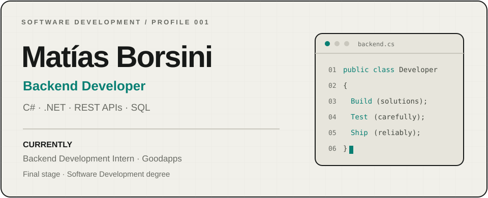
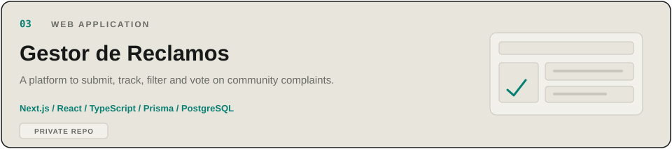

<picture>
  <source media="(prefers-color-scheme: dark)" srcset="assets/hero-dark.svg" />
  
</picture>

<a href="https://www.linkedin.com/in/matias-borsini-92964744b/">
  <picture>
    <source media="(prefers-color-scheme: dark)" srcset="assets/btn-linkedin-dark.svg" />
    
  </picture>
</a>
<a href="https://github.com/MatiasBorsini">
  <picture>
    <source media="(prefers-color-scheme: dark)" srcset="assets/btn-github-dark.svg" />
    
  </picture>
</a>

<picture>
  <source media="(prefers-color-scheme: dark)" srcset="assets/about-head-dark.svg" />
  
</picture>

Soy desarrollador de software, enfocado en el **desarrollo backend con C# y .NET**. Disfruto crear APIs, integrar sistemas y transformar necesidades reales en soluciones prácticas y confiables.

Actualmente me desempeño como **pasante de Desarrollo Backend en Goodapps**, donde colaboro en el desarrollo y la migración de APIs, pruebas, control de versiones y despliegues. También estoy en la etapa final de mi carrera de Desarrollo de Software.

 

<picture>
  <source media="(prefers-color-scheme: dark)" srcset="assets/work-head-dark.svg" />
  
</picture>

<picture>
  <source media="(prefers-color-scheme: dark)" srcset="assets/work-localinfantil-dark.svg" />
  
</picture>

<picture>
  <source media="(prefers-color-scheme: dark)" srcset="assets/work-agente-ia-moda-dark.svg" />
  
</picture>

<picture>
  <source media="(prefers-color-scheme: dark)" srcset="assets/work-gestor-reclamos-dark.svg" />
  
</picture>

El código fuente de estos proyectos se encuentra actualmente en repositorios privados.

  

<picture>
  <source media="(prefers-color-scheme: dark)" srcset="assets/stack-dark.svg" />
  
</picture>

Diseño de la sección inspirado en el perfil de <a href="https://github.com/aahil-khan/aahil-khan">Aahil Khan</a>, adaptado a mis tecnologías y proyectos. Logotipos: <a href="https://github.com/devicons/devicon">Devicon</a> y <a href="https://github.com/simple-icons/simple-icons">Simple Icons</a>.

  

<a href="https://www.linkedin.com/in/matias-borsini-92964744b/">
  <picture>
    <source media="(prefers-color-scheme: dark)" srcset="assets/footer-dark.svg" />
    
  </picture>
</a>

Diseño e ilustraciones creados para el perfil de Matías Borsini.
