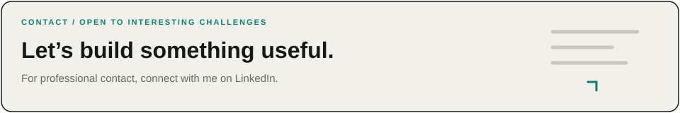

<picture>
  <source media="(prefers-color-scheme: dark)" srcset="assets/hero-dark.svg" />
  
</picture>

<a href="https://www.linkedin.com/in/matias-borsini-92964744b/">
  <picture>
    <source media="(prefers-color-scheme: dark)" srcset="assets/btn-linkedin-dark.svg" />
    
  </picture>
</a>
<a href="https://github.com/MatiasBorsini">
  <picture>
    <source media="(prefers-color-scheme: dark)" srcset="assets/btn-github-dark.svg" />
    
  </picture>
</a>

I’m a software developer focused on **backend engineering with C# and .NET**. I enjoy building APIs, integrating systems, and turning real requirements into practical, reliable software.

Currently, I’m a **Backend Development Intern at Goodapps**, contributing to API development and migration, testing, version control, and deployments. I’m also in the final stage of my Software Development degree.

 

<picture>
  <source media="(prefers-color-scheme: dark)" srcset="assets/work-head-dark.svg" />
  
</picture>

<picture>
  <source media="(prefers-color-scheme: dark)" srcset="assets/work-localinfantil-dark.svg" />
  
</picture>

<picture>
  <source media="(prefers-color-scheme: dark)" srcset="assets/work-agente-ia-moda-dark.svg" />
  
</picture>

<picture>
  <source media="(prefers-color-scheme: dark)" srcset="assets/work-gestor-reclamos-dark.svg" />
  
</picture>

Project source code is currently kept in private repositories.

  

<picture>
  <source media="(prefers-color-scheme: dark)" srcset="assets/stack-dark.svg" />
  
</picture>

  

<a href="https://www.linkedin.com/in/matias-borsini-92964744b/">
  <picture>
    <source media="(prefers-color-scheme: dark)" srcset="assets/footer-dark.svg" />
    
  </picture>
</a>

Profile design and illustrations created for Matías Borsini.
